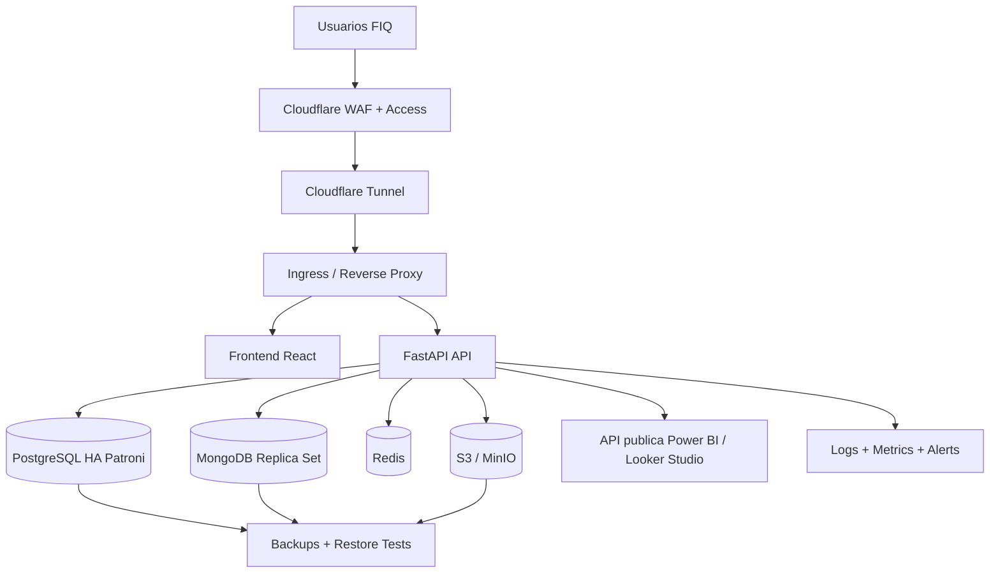

# 14. Plan de Producción HA, Kubernetes/Swarm y Dashboards Externos

## Decisión de Orquestación

Kubernetes y Docker Swarm no se deben mezclar como un único plano de control. Para FIQ se define:

- **Kubernetes:** destino recomendado para producción HA y evolución institucional.
- **Docker Swarm:** alternativa operativa si el equipo necesita un clúster más simple en VPS antes de adoptar Kubernetes.
- **Docker Compose:** entorno local y laboratorio, no frontera final de alta disponibilidad.

## Topología Real Seleccionada

El clúster HA se opera con cinco nodos de quorum y un watcher externo:

| Nodo | Host | Acceso | Rol previsto | Red privada |
| :--- | :--- | :--- | :--- | :--- |
| `parrot` | `100.79.244.99` | `oti@100.79.244.99` | k3s server, PostgreSQL HA, Patroni/HAProxy | Tailscale `100.79.244.99` |
| `abc` | `147.224.242.204` | `ubuntu@147.224.242.204` | k3s server, app, shard, PostgreSQL HA | Tailscale `100.97.171.89` |
| `server` | `147.15.114.98` | `ubuntu@147.15.114.98` | k3s server, app, shard, PostgreSQL HA | Tailscale `100.87.33.2` |
| `arch` | host local | este equipo | k3s server, PostgreSQL HA | Tailscale `100.110.204.72` |
| `debian` | VPS Debian | `jhulio@100.94.200.89` | k3s server, PostgreSQL HA | Tailscale `100.94.200.89` |
| `ocri` | `167.234.255.122` | `jhulio@167.234.255.122` | Watcher externo y bot Telegram principal | Tailscale `100.122.189.103` |

Esta topología permite quorum de 5 miembros para Kubernetes/etcd. Patroni usa Kubernetes DCS sobre ese plano de control. `ocri` no participa en quorum; observa desde fuera y mantiene el bot principal por systemd.

`ocri` no debe alojar datos ni control-plane: tiene cerca de 1 GiB RAM. Su valor es monitoreo externo, alerta temprana y bot Telegram.

Estado operativo inicial:

- Los cinco nodos de quorum tienen Tailscale operativo.
- El runtime de producción es k3s HA. Docker Compose queda apagado y solo sirve como rollback manual de emergencia.
- `ocri` conserva `fiq-telegram-bot.service` como bot principal; no ejecutar otro consumidor de Telegram con el mismo token.

Para pruebas, se evaluó crear una VM dentro de `fiq-node-2`, pero el host no expone virtualización KVM (`vmx/svm = 0`). La alternativa de laboratorio es usar Kubernetes en contenedores con `infra/lab/oti-kubernetes/`, aceptando que no representa alta disponibilidad real.

## Arquitectura Objetivo

## Fases

### Fase 0: Base ya disponible

- `compose.yaml` local con PostgreSQL, MongoDB, Redis, MinIO, backend y frontend.
- PostgreSQL HA definido para Kubernetes con `patroni` y `postgres-haproxy` como `DaemonSet` sobre los cinco nodos etiquetados `fiq.uncp.edu.pe/postgres-ha=true`; Patroni usa Kubernetes DCS y no un `postgres-etcd` separado.
- MongoDB documental queda desactivado en el runtime Kubernetes actual hasta reintroducirlo con operador o servicio gestionado.
- API para Power BI y Looker Studio/Data Studio con `/reports/public/*` protegida por `DASHBOARD_API_KEY`.

### Fase 1: Hardening de Configuración

- Separar `compose.yaml` local y `compose.prod.yaml` si se mantiene VPS.
- Sacar secretos de archivos versionados: usar `.env.prod`, Docker secrets, Kubernetes Secrets o External Secrets.
- Definir rotación de `SECRET_KEY`, `DASHBOARD_API_KEY`, credenciales S3, PostgreSQL y MongoDB.
- Activar CORS explícito para frontend, Power BI y dominios institucionales.
- Evitar exponer puertos de bases de datos públicamente; solo red interna o VPN.

### Fase 2: MongoDB Seguro y HA

Objetivo: replica set de 3 miembros en nodos distintos.

- `mongo-0` en `fiq-node-1`, `mongo-1` en `fiq-node-2`, `mongo-2` en `fiq-node-3`, con persistencia independiente.
- Autenticación obligatoria.
- Keyfile interno para autenticación entre réplicas.
- TLS interno si el clúster cruza redes no confiables.
- Usuario app con permisos mínimos sobre `fiq_events`.
- Usuario backup solo lectura.
- Backups lógicos con `mongodump` y restore test mensual.
- Restore test mensual en entorno aislado.

### Fase 3: PostgreSQL HA

Mantener Patroni/HAProxy como línea base en Kubernetes:

- 5 nodos PostgreSQL sobre las IP Tailscale actuales.
- 5 nodos k3s server con etcd embebido para quorum del plano de control.
- Patroni usando Kubernetes DCS para elección de líder PostgreSQL.
- HAProxy o PgBouncer para entrada estable.
- Backups base + WAL archiving.
- Restore test documentado.
- Métricas de replicación, lag y failover.

El criterio operativo es que el backend use el endpoint de HAProxy `:5000`, no un PostgreSQL fijo. Si cae el lider, Patroni promueve una replica y HAProxy redirige escrituras al nuevo lider; el usuario puede notar unos segundos de reconexion, pero no una perdida sostenida de acceso.

Para distribuir carga SQL transaccional, el backend separa conexiones:

- `DATABASE_URL`: endpoint de escritura HAProxy `:5000`, usado por autenticacion, uploads, moderacion, contadores y auditoria.
- `DATABASE_READ_URL`: endpoint de lectura HAProxy `:5001`, usado por listados publicos, laboratorios sin auditoria y reportes SQL.
- Si `DATABASE_READ_URL` no se define, las lecturas usan `DATABASE_URL` para conservar compatibilidad local.

Para carga masiva de biblioteca/recursos, el runtime Kubernetes usa sharding real:

- `resource-shard`: `StatefulSet` PostgreSQL con 2 replicas/shards en nodos app distintos.
- Distribucion deterministica por `curso_id` para repartir datos y consultas de recursos.
- Seed de prueba productiva con 50 000 registros, 25 000 por shard.

### Fase 4: Kubernetes

Crear `infra/k8s/` con:

- `Namespace` por entorno: `fiq-staging`, `fiq-prod`.
- `Deployment` para backend, frontend y cloudflared.
- `Service` interno para backend/frontend.
- `Ingress` si no se usa solo Cloudflare Tunnel.
- `ConfigMap` para configuración no sensible.
- `Secret` o ExternalSecret para credenciales.
- `CronJob` para backups.
- `NetworkPolicy` para aislar bases de datos.
- Probes: readiness/liveness/startup.
- Requests/limits por pod.
- HPA para backend y frontend.

Base de datos en Kubernetes:

- Preferible usar operadores: CloudNativePG/Zalando para PostgreSQL y MongoDB Community/Enterprise Operator para MongoDB.
- Si no se usan operadores, mantener Postgres/Mongo fuera del clúster y conectar por red privada/VPN.

### Fase 5: Docker Swarm Fallback

Crear `infra/swarm/` con:

- Stack file `fiq-stack.yaml`.
- Overlay network.
- Docker secrets.
- Replicas de backend/frontend.
- Servicios externos para PostgreSQL HA y Mongo replica set.
- Rolling update y rollback config.
- Healthchecks obligatorios.

Swarm no debe administrar datos críticos sin una estrategia clara de volúmenes por nodo, backups y recuperación.

### Fase 6: Observabilidad

Mínimo aceptable:

- Logs centralizados del backend, frontend, cloudflared, PostgreSQL, MongoDB y backups.
- Métricas HTTP: latencia p95, 4XX, 5XX, throughput.
- Métricas DB: conexiones, locks, replicación, tamaño, cache hit, slow queries.
- Alertas: API caída, error 5XX alto, disco > 80%, backup fallido, replica lag, Mongo primary no disponible.
- Dashboard técnico separado del dashboard académico Power BI.

### Fase 7: Power BI y Looker Studio

No conectar Power BI ni Looker Studio directo a PostgreSQL o MongoDB. Usar API pública controlada:

- `GET /reports/public/dashboard-data`
- `GET /reports/public/resources`
- `GET /reports/public/courses`
- `GET /reports/public/users`
- `GET /reports/public/activities`
- `GET /reports/public/document-metrics`
- `GET /reports/public/looker-studio/tables`
- `GET /reports/public/looker-studio/schema/{table_name}`
- `GET /reports/public/looker-studio/data/{table_name}`

Seguridad:

- `DASHBOARD_API_KEY` obligatorio.
- Cloudflare WAF/rate limit.
- Respuestas agregadas, no secretos ni tokens.
- No exponer contraseñas, URLs internas ni campos sensibles.
- Logs de acceso para auditoría.

Modelo Power BI:

- Tabla `resources`: recursos, tipos, cursos, vistas, descargas.
- Tabla `activities`: eventos SQL por fecha/tipo.
- Tabla `document_metrics.activity_events.by_type`: eventos Mongo por tipo.
- Tabla `document_metrics.activity_events.by_date`: eventos Mongo por fecha.
- Tabla `document_metrics.external_catalog_cache.by_kind`: búsquedas externas por tipo.
- Tabla `document_metrics.external_catalog_cache.recent`: snapshots recientes del cache externo.

Modelo Looker Studio/Data Studio:

- Tabla `summary`: métricas globales en formato clave/valor.
- Tabla `resources`: recursos con dimensiones planas y fecha `YYYYMMDD`.
- Tabla `courses`: cursos.
- Tabla `users`: usuarios sin email para reducir exposición de datos personales.
- Tabla `activities`: eventos con `cantidad=1` para agregación.
- Tablas Mongo planas: `document_activity_by_type`, `document_activity_by_date`, `external_cache_by_kind`, `external_cache_recent`.

## Criterios de Listo

- `docker compose config` sin warnings.
- `uv run --extra dev python -m pytest` pasando.
- `npm run openapi:check` pasando.
- Secretos fuera del repo.
- Backups ejecutados y restore probado.
- Endpoint Power BI/Looker Studio con API key y dataset validado.
- Runbook de failover PostgreSQL y MongoDB.
- Monitoreo con alertas probadas.
