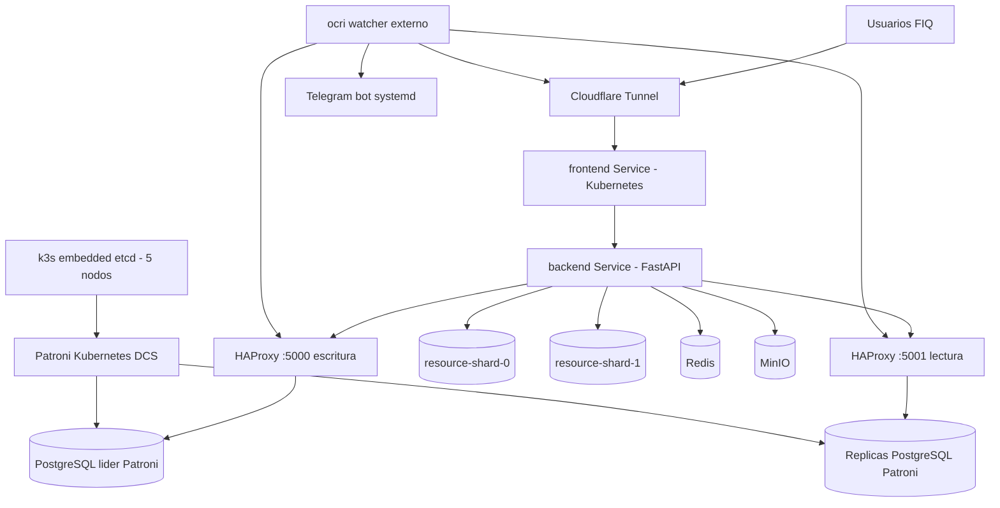

# UNIVERSIDAD NACIONAL DEL CENTRO DEL PERU
## FACULTAD DE INGENIERIA QUIMICA

---

### INFORME TECNICO
**"Arquitectura real de alta disponibilidad para la Plataforma Digital FIQ con Kubernetes, PostgreSQL Patroni, HAProxy y sharding"**

#### INTEGRANTES
* Moran de la Cruz Jhulio Alessandro
* Palomino Chacon Hernando
* Pando Vargas Josue Samuel
* Porras Falcon Alexander Neil
* Vargas Laime Andy Rodick

#### DOCENTE
* Mercado Rivas Richard Yuri

**HUANCAYO - PERU**
**2026**

---

## 1. Introduccion

El presente informe tecnico describe la arquitectura real implementada para la Plataforma Digital de la Facultad de Ingenieria Quimica (FIQ-UNCP). La solucion no utiliza SQL Server Always On ni Windows Server Failover Clustering. La implementacion operativa se basa en Linux, Kubernetes k3s, PostgreSQL 17, Patroni, HAProxy, Redis, MinIO, Prometheus, Grafana, Cloudflare Tunnel y un watcher externo con bot de Telegram.

La plataforma fue desplegada en un cluster Kubernetes de cinco nodos de quorum conectados por Tailscale. El objetivo es mantener disponibilidad de aplicacion, base de datos y monitoreo externo aun cuando uno de los nodos falle o se degrade. La aplicacion web entra por Cloudflare Tunnel hacia servicios internos de Kubernetes; el backend FastAPI opera con PostgreSQL HA mediante HAProxy, y la carga masiva de recursos academicos se distribuye mediante sharding real en dos shards PostgreSQL.

Este informe actualiza la documentacion a lo que existe realmente en produccion al 22 de julio de 2026.

## 2. Objetivos

### 2.1. Objetivo general

Implementar una arquitectura de alta disponibilidad basada en Kubernetes y PostgreSQL HA que permita continuidad operativa de la Plataforma Digital FIQ, con failover de base de datos, entrada publica controlada, monitoreo externo y distribucion de carga mediante sharding.

### 2.2. Objetivos especificos

- Operar la plataforma sobre Kubernetes k3s en cinco nodos `server/control-plane/etcd`.
- Mantener PostgreSQL en alta disponibilidad con Patroni y HAProxy.
- Usar HAProxy como listener estable para escritura y lectura SQL.
- Separar carga de recursos academicos mediante shards PostgreSQL.
- Ejecutar backend, frontend, Redis, MinIO, Cloudflare Tunnel y shards como recursos Kubernetes.
- Mantener un watcher externo fuera del quorum para detectar fallas desde otra maquina.
- Usar el bot principal de Telegram por systemd en `ocri`, evitando consumidores duplicados del mismo token.
- Mantener secretos fuera de Git mediante Kubernetes Secrets y archivos `.env` no versionados.

## 3. Topologia real implementada

El cluster de produccion se compone de cinco nodos de quorum y un watcher externo:

| Nodo | Host / acceso | IP Tailscale | Rol real |
| :--- | :--- | :--- | :--- |
| `abc` | `ubuntu@147.224.242.204` | `100.97.171.89` | k3s server, etcd, Patroni, HAProxy, backend, frontend, Cloudflare Tunnel, shard |
| `server` | `ubuntu@147.15.114.98` | `100.87.33.2` | k3s server, etcd, Patroni, HAProxy, backend, frontend, Cloudflare Tunnel, shard |
| `arch` | equipo local | `100.110.204.72` | k3s server, etcd, Patroni, HAProxy |
| `debian` | VPS Debian | `100.94.200.89` | k3s server, etcd, Patroni, HAProxy |
| `parrot` | `oti@100.79.244.99` | `100.79.244.99` | k3s server, etcd, Patroni, HAProxy |
| `ocri` | `jhulio@167.234.255.122` | `100.122.189.103` | watcher externo y bot principal de Telegram |

`ocri` no participa en quorum, no aloja datos y no ejecuta control-plane. Su funcion es observar la disponibilidad desde fuera y mantener el bot principal `fiq-telegram-bot.service`.

## 4. Arquitectura general

## 5. Kubernetes como runtime de produccion

La produccion se ejecuta sobre k3s HA. Docker Compose quedo apagado en los VPS Ubuntu y se conserva solo como rollback manual o laboratorio.

Componentes desplegados en el namespace `fiq-prod`:

- `backend`: 2 replicas, una en `abc` y otra en `server`.
- `frontend`: 3 replicas distribuidas en nodos de aplicacion.
- `cloudflare-tunnel`: 2 replicas, una en `abc` y otra en `server`.
- `prometheus`, `kube-state-metrics`, `node-exporter` y `grafana`: observabilidad del cluster, nodos, pods y Patroni.
- `redis`: servicio auxiliar para cache/colas.
- `minio`: almacenamiento S3 compatible.
- `resource-shard`: StatefulSet de 2 shards PostgreSQL.
- `patroni`: DaemonSet hostNetwork en los cinco nodos de datos.
- `postgres-haproxy`: DaemonSet hostNetwork en los cinco nodos.

Estado operativo verificado:

- La aplicacion responde por Cloudflare Tunnel con `HTTP 200`.
- `/api/health` responde `{"status":"ok","version":"1.0.0"}`.
- Los pods principales de backend, frontend, Redis, MinIO, Cloudflare Tunnel, HAProxy y shards estan en ejecucion.
- Los jobs de migracion y seed terminaron como `Completed`.

## 6. PostgreSQL HA con Patroni y HAProxy

PostgreSQL es la base transaccional principal. Patroni administra liderazgo, replicas y failover. En esta implementacion Patroni usa Kubernetes DCS sobre el plano de control k3s; no se ejecuta un `postgres-etcd` separado.

HAProxy cumple el rol de listener estable:

- Puerto `5000`: escrituras hacia el lider PostgreSQL.
- Puerto `5001`: lecturas hacia replicas disponibles.
- Puerto `7000`: estadisticas de HAProxy.

Estado verificado de Patroni:

| Miembro | Host | Rol | Estado | Lag |
| :--- | :--- | :--- | :--- | :--- |
| `patroni-k2rfs` | `100.97.171.89` | Leader | running | - |
| `patroni-8htb2` | `100.110.204.72` | Replica | streaming | 0 |
| `patroni-drk6x` | `100.79.244.99` | Replica | streaming | 0 |
| `patroni-mrqg7` | `100.87.33.2` | Replica | streaming | 0 |
| `patroni-ppgd4` | `100.94.200.89` | Replica | streaming | 0 |

Esto demuestra que la capa de datos conserva un lider y cuatro replicas en streaming. Si el lider deja de responder, Patroni puede promover una replica y HAProxy mantiene el punto de conexion estable para el backend.

## 7. Sharding real para recursos academicos

Ademas de la alta disponibilidad de PostgreSQL principal, se implemento sharding real para distribuir carga de recursos academicos. El runtime Kubernetes usa un `StatefulSet` llamado `resource-shard` con dos replicas:

- `resource-shard-0` en `server`.
- `resource-shard-1` en `abc`.

La distribucion se realiza de forma deterministica por `curso_id`, de manera que la carga de recursos no se concentra en una sola base. Para validar el comportamiento se poblo la plataforma con 50 000 registros de prueba:

- `resource-shard-0`: 25 000 recursos.
- `resource-shard-1`: 25 000 recursos.

Este sharding no reemplaza a PostgreSQL HA transaccional; lo complementa para carga masiva y consultas de biblioteca/recursos.

## 8. Entrada publica con Cloudflare Tunnel

La entrada publica actual usa Cloudflare Tunnel desde Kubernetes. Se ejecuto con `--protocol http2` para evitar fallos de QUIC/UDP 7844 en los VPS.

URLs publicas operativas al momento de la verificacion:

- `https://entirely-develop-patent-cordless.trycloudflare.com`
- `https://inquire-floating-mind-employees.trycloudflare.com`

Ambas responden el frontend y `/api/health`. Sin embargo, estas URLs son quick tunnels de Cloudflare y no tienen garantia de permanencia. Para produccion formal se debe crear un named tunnel y asociarlo a un subdominio fijo, por ejemplo `fiq.<dominio-institucional>`.

## 9. Observabilidad con Prometheus y Grafana

Se agrego observabilidad dentro de Kubernetes con Prometheus y Grafana. Prometheus recolecta metricas de Kubernetes, `kube-state-metrics`, `node-exporter` y Patroni. Grafana queda aprovisionado con Prometheus como datasource y un dashboard inicial `FIQ HA Overview`.

Grafana se expone temporalmente por Cloudflare Tunnel en:

- `https://opinion-feeding-bali-father.trycloudflare.com`

Como ocurre con las URLs principales de la aplicacion, este enlace es un quick tunnel y debe reemplazarse por un named tunnel con subdominio fijo para produccion formal.

## 10. Watcher externo y bot de Telegram

El host `ocri` opera como watcher externo. Se encontro que existia un servicio systemd antiguo `fiq-telegram-bot.service` y un contenedor Docker intentando consumir el mismo bot de Telegram, lo que podia causar `409 Conflict` por multiples consumidores del mismo token.

La arquitectura real quedo definida asi:

- Se conserva `fiq-telegram-bot.service` por systemd porque contiene la logica principal del bot.
- Se apaga el contenedor Docker duplicado del bot/watcher.
- `fiq-watcher.timer` ejecuta los chequeos periodicos.
- El watcher monitorea Cloudflare, API, Grafana, k3s API, HAProxy y endpoints Patroni por Tailscale.

Estado verificado:

- `fiq-telegram-bot.service`: activo.
- `fiq-watcher.timer`: activo.
- Ultima ejecucion de `fiq-watcher.service`: exitosa.
- No quedan contenedores Docker duplicados del bot en `ocri`.

## 11. Seguridad y gestion de secretos

Medidas aplicadas:

- Comunicacion privada entre nodos por Tailscale.
- PostgreSQL, Patroni y HAProxy expuestos solo sobre red privada.
- Entrada publica controlada por Cloudflare Tunnel.
- Secretos reales fuera de Git.
- Llaves SSH ignoradas mediante `.gitignore`.
- Kubernetes Secrets para credenciales de aplicacion, PostgreSQL, shards, MinIO y API keys.
- Separacion de `ocri` como watcher sin datos ni voto de quorum.

## 12. Estado actual y observaciones

Estado real verificado el 22 de julio de 2026:

- La aplicacion publica responde por Cloudflare Tunnel.
- Backend y frontend estan activos en Kubernetes.
- PostgreSQL HA esta sano con lider y cuatro replicas en streaming.
- Los shards estan activos y poblados con datos de prueba.
- Los Compose antiguos de `abc` y `server` fueron apagados.
- `ocri` mantiene el bot principal por systemd y el watcher externo.

Observacion operativa importante:

- El nodo `parrot`/`oti` presento degradacion temporal como nodo Kubernetes (`NotReady`) por timeouts del API/etcd local. Se reinicio el host y `k3s` volvio a `active/running`; tras una fluctuacion inicial, la ultima verificacion mostro nuevamente los cinco nodos `Ready`.
- Durante la degradacion, la capa PostgreSQL Patroni siguio reportando la replica de `parrot` en `streaming`, y la plataforma publica siguio respondiendo por los nodos `abc` y `server`.

## 13. Failover y recuperacion

### 13.1. Falla del lider PostgreSQL

1. Patroni detecta que el lider no responde.
2. Kubernetes DCS mantiene el estado del cluster.
3. Patroni promueve una replica disponible.
4. HAProxy redirige el puerto `5000` hacia el nuevo lider.
5. El backend puede requerir reconexion breve, pero no cambia su cadena de conexion.

### 13.2. Falla de un nodo de aplicacion

Si cae `abc` o `server`, Kubernetes mantiene replicas del frontend/backend/tunnel en el otro nodo de aplicacion. El servicio puede degradarse, pero no depende de un unico contenedor Docker.

### 13.3. Falla del watcher

Si cae `ocri`, la plataforma sigue funcionando. Lo que se pierde temporalmente es la observacion externa y las alertas por Telegram.

## 14. Pendientes para produccion formal

- Crear un Cloudflare named tunnel y asociarlo a un subdominio fijo.
- Reemplazar las URLs `trycloudflare.com` por el dominio definitivo.
- Mantener observacion de `parrot`; si vuelve a `NotReady`, removerlo del quorum k3s y reingresarlo limpio.
- Automatizar backups y pruebas de restauracion.
- Definir retencion y rotacion de secretos.

## 15. Conclusion

La Plataforma Digital FIQ cuenta con una arquitectura real de alta disponibilidad basada en Kubernetes k3s, PostgreSQL Patroni, HAProxy y sharding de recursos. La solucion implementada cumple el objetivo practico de continuidad operativa: entrada publica por Cloudflare, replicas de aplicacion, base de datos con lider y replicas en streaming, listener estable para SQL y watcher externo con Telegram.

La arquitectura ya no depende de Docker Compose como runtime productivo ni de un unico servidor de base de datos. Los puntos pendientes mas importantes para uso formal son reemplazar los quick tunnels por un subdominio fijo de Cloudflare y mantener observacion del nodo `parrot` despues de su recuperacion.
